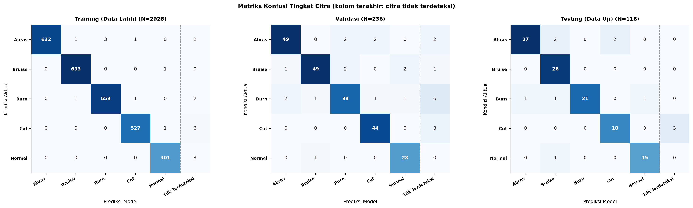
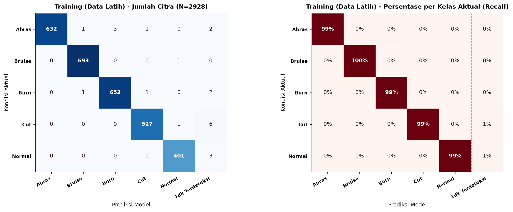
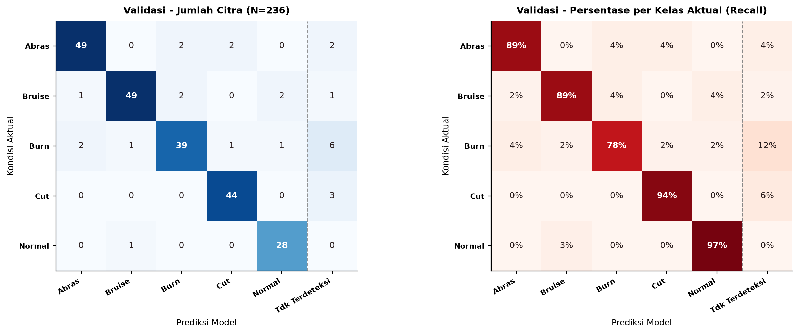
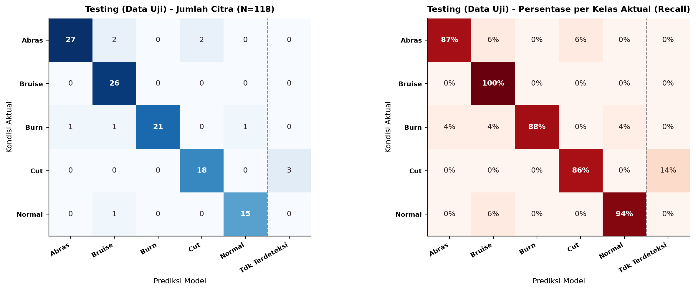
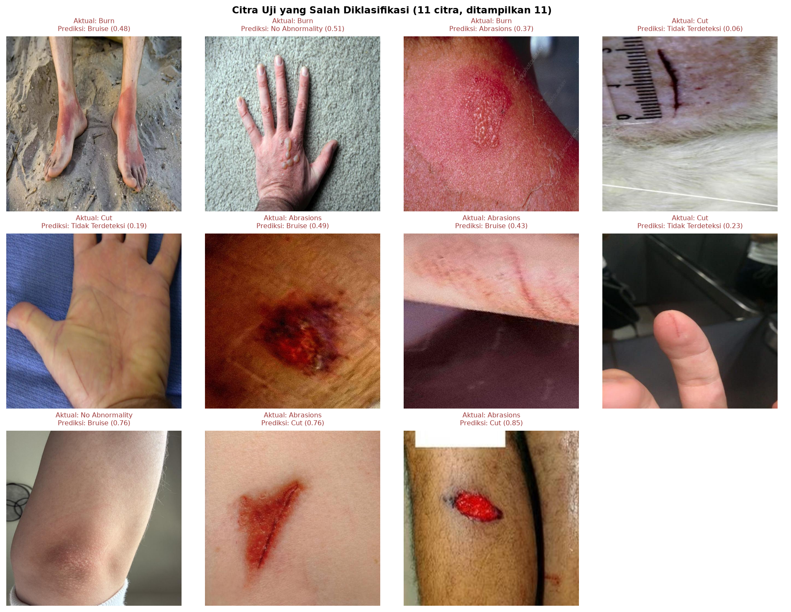
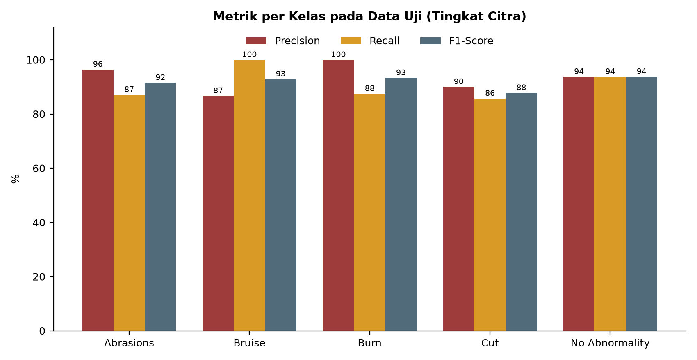
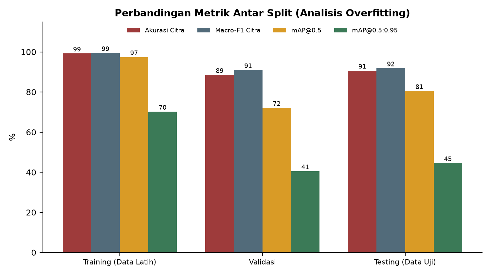
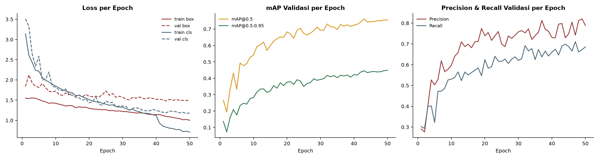
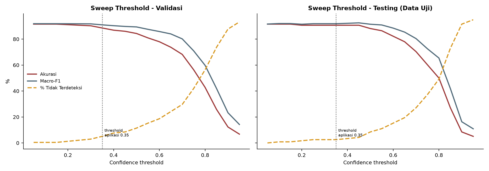
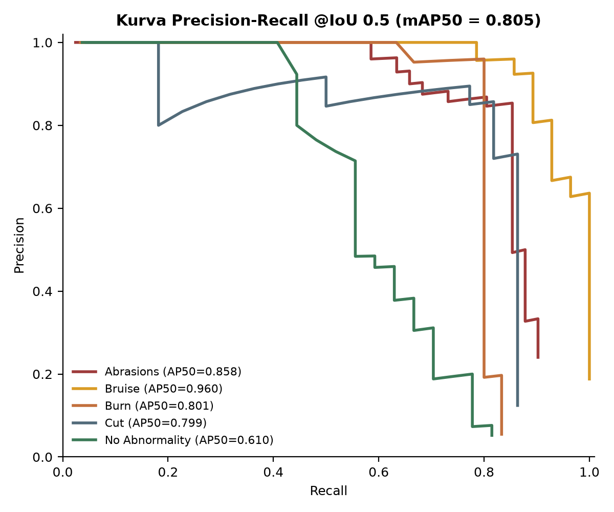

# Laporan Evaluasi Model Deteksi & Klasifikasi Luka Kulit (YOLOv8)

> Dibuat otomatis oleh `scripts/generate_report.py` pada **2026-10-29T17:33:08**. Seluruh angka dihitung langsung dari model — **bukan** nilai yang diketik manual.

| Item | Nilai |
|---|---|
| Model | `models\wound_yolov8n.onnx` (model yang sama dengan aplikasi) |
| Threshold keyakinan evaluasi citra | 0.35 (sama dengan status *Terdeteksi* di aplikasi) |
| IoU NMS | 0.45 |
| Aturan label citra (ground truth) | kelas dominan (jumlah box terbanyak) pada label citra |
| Aturan prediksi citra | kelas box skor tertinggi bila skor >= threshold, selain itu 'Tidak Terdeteksi' |
| Perangkat | Intel64 Family 6 Model 126 Stepping 5, GenuineIntel — Windows 11 / Python 3.12.10 |

## 1. Dataset yang Dievaluasi

| Split | Jumlah citra | Abrasions | Bruise | Burn | Cut | No Abnormality |
|---|---|---|---|---|---|---|
| Training | 2934 | 639 | 693 | 657 | 534 | 405 |
| Validasi | 236 | 55 | 55 | 50 | 47 | 29 |
| Testing | 118 | 31 | 26 | 24 | 21 | 16 |

**Catatan metodologis penting:**

- Split train berisi citra hasil augmentasi Roboflow (±3x citra asli). Metrik pada split *training* sebaiknya hanya dipakai untuk melihat *seberapa baik model menghafal*, bukan sebagai ukuran kinerja.
- **Pembersihan kebocoran data (*data leakage*)**: 38 citra validasi dan 19 citra uji yang identik/sangat mirip dengan citra latih (perceptual hash, jarak Hamming ≤ 4) dikeluarkan (disimpan di `dataset_removed/`). Tanpa langkah ini, akurasi uji akan terlihat lebih tinggi dari kenyataan.
- Label citra diturunkan dari anotasi *bounding box* (kelas dominan), karena dataset berbasis deteksi objek.

## 2. Definisi TP, FP, FN, TN pada Konteks Luka

Evaluasi dilakukan **satu kelas terhadap sisanya** (*One-vs-Rest*). Contoh untuk kelas **Cut (luka sayat)**:

| Istilah | Arti | Contoh (kelas Cut) |
|---|---|---|
| **TP** (True Positive) | Citra kelas X diprediksi X | Luka sayat → diprediksi *Cut* ✔ |
| **FP** (False Positive) | Citra bukan X diprediksi X | Luka lecet → diprediksi *Cut* (alarm salah) |
| **FN** (False Negative) | Citra kelas X tidak diprediksi X (salah kelas **atau** tidak terdeteksi) | Luka sayat → diprediksi *Bruise*, atau tidak ada deteksi (bahaya: pengguna tidak diberi panduan) |
| **TN** (True Negative) | Citra bukan X dan tidak diprediksi X | Memar → diprediksi *Bruise* (bukan *Cut*) ✔ |

> Kolom **Tidak Terdeteksi** pada matriks konfusi menampung citra yang skor deteksinya di bawah threshold. Itu dihitung sebagai **FN** untuk kelas aslinya sehingga *Recall* tidak dibesar-besarkan.

## 3. Rumus Metrik & Cara Membacanya

| Metrik | Rumus | Pertanyaan yang dijawab | Prioritas pada P3K |
|---|---|---|---|
| Accuracy | (TP+TN) / N | Dari semua citra, berapa yang benar? | Gambaran umum (menyesatkan bila kelas tak seimbang) |
| Precision | TP / (TP+FP) | Saat model bilang kelas X, seberapa sering benar? | Mengurangi alarm/panduan yang salah |
| Recall (Sensitivitas) | TP / (TP+FN) | Dari semua kasus X nyata, berapa yang ditemukan? | **Tertinggi** — kasus terlewat berbahaya |
| Specificity | TN / (TN+FP) | Dari semua non-X, berapa yang benar dikenali sebagai non-X? | Menghindari penanganan berlebihan |
| NPV | TN / (TN+FN) | Saat model bilang bukan X, seberapa sering benar? | Kepercayaan pada hasil negatif |
| F1-Score | 2·P·R / (P+R) | Keseimbangan Precision & Recall | Ringkasan per kelas |
| Macro avg | rata-rata sederhana per kelas | Semua kelas dianggap sama penting | Utama (adil untuk kelas kecil) |
| Weighted avg | rata-rata berbobot jumlah sampel | Mencerminkan komposisi data | Pembanding |
| Balanced Accuracy | rata-rata Recall per kelas | Akurasi yang tidak bias kelas besar | Pembanding |
| Cohen's Kappa | (po − pe) / (1 − pe) | Kesepakatan melebihi kebetulan (0–1) | Validasi kekokohan |
| MCC | korelasi prediksi–aktual multikelas (−1…1) | Metrik tunggal paling ketat | Validasi kekokohan |
| IoU | Area(A∩B) / Area(A∪B) | Seberapa pas kotak prediksi dengan kotak asli | Kualitas lokalisasi |
| AP / mAP | luas di bawah kurva Precision–Recall, dirata-rata antar kelas | Kualitas deteksi di semua threshold keyakinan | Metrik standar YOLO |

**mAP@0.5** = AP dengan kotak dianggap benar bila IoU ≥ 0.5. **mAP@0.5:0.95** = rata-rata AP pada IoU 0.50, 0.55, …, 0.95 (jauh lebih ketat). Interval kepercayaan 95%: *bootstrap* 2.000× untuk Accuracy & Macro-F1, *Wilson* untuk Recall/Precision per kelas.

## 4. Contoh Perhitungan Langkah demi Langkah (Data Uji)

Kelas dengan F1 terendah pada data uji: **Cut** (N total = 118).

```text
TP = 18   FP = 2   FN = 3   TN = 118 - 18 - 2 - 3 = 95
Precision   = TP/(TP+FP) = 18/(18+2) = 0.9000
Recall      = TP/(TP+FN) = 18/(18+3) = 0.8571
Specificity = TN/(TN+FP) = 95/(95+2) = 0.9794
F1-Score    = 2·P·R/(P+R) = 2·0.9000·0.8571/(0.9000+0.8571) = 0.8780
Accuracy keseluruhan = diagonal/N = 107/118 = 0.9068
```

## 5. Ringkasan Metrik per Split

| Split | N | Accuracy | Bal. Acc | Precision (macro) | Recall (macro) | F1 (macro) | Kappa | MCC | Tdk terdeteksi | mAP@0.5 | mAP@0.5:0.95 |
|---|---|---|---|---|---|---|---|---|---|---|---|
| Training | 2928 | 99.25% | 99.22% | 99.68% | 99.22% | 99.45% | 0.991 | 0.991 | 13 | 0.974 | 0.702 |
| Validasi | 236 | 88.56% | 89.27% | 92.99% | 89.27% | 90.97% | 0.858 | 0.860 | 12 | 0.721 | 0.405 |
| Testing | 118 | 90.68% | 90.81% | 93.37% | 90.81% | 91.85% | 0.883 | 0.885 | 3 | 0.805 | 0.445 |

**Data uji — interval kepercayaan 95%:** Accuracy 90.7% [84.7% - 95.8%], Macro-F1 91.9% [86.6% - 96.3%].

> Karena data uji hanya **118 citra**, rentang CI cukup lebar. Satu citra salah mengubah akurasi ≈ 0.85 poin. Klaim kinerja sebaiknya memakai rentang ini, bukan satu angka.



## 6.1 Rincian Split Training

**Matriks konfusi (jumlah citra)** — diagonal tebal = benar:

| Aktual \ Prediksi | Abrasions | Bruise | Burn | Cut | No Abnormality | Tidak Terdeteksi | Total |
|---|---|---|---|---|---|---|---|
| **Abrasions** | **632** | 1 | 3 | 1 | 0 | 2 | 639 |
| **Bruise** | 0 | **693** | 0 | 0 | 1 | 0 | 694 |
| **Burn** | 0 | 1 | **653** | 1 | 0 | 2 | 657 |
| **Cut** | 0 | 0 | 0 | **527** | 1 | 6 | 534 |
| **No Abnormality** | 0 | 0 | 0 | 0 | **401** | 3 | 404 |
| **Total prediksi** | **632** | **695** | **656** | **529** | **403** | **13** | **2928** |

| Kelas | Support | TP | FP | FN | TN | Precision | Recall [CI95] | Specificity | F1 | Tdk terdeteksi |
|---|---|---|---|---|---|---|---|---|---|---|
| Luka lecet (Abrasions) | 639 | 632 | 0 | 7 | 2289 | 100.0% | 98.9% [97.8% - 99.5%] | 100.0% | 99.4% | 2 |
| Luka memar (Bruise) | 694 | 693 | 2 | 1 | 2232 | 99.7% | 99.9% [99.2% - 100.0%] | 99.9% | 99.8% | 0 |
| Luka bakar (Burn) | 657 | 653 | 3 | 4 | 2268 | 99.5% | 99.4% [98.4% - 99.8%] | 99.9% | 99.5% | 2 |
| Luka sayat (Cut) | 534 | 527 | 2 | 7 | 2392 | 99.6% | 98.7% [97.3% - 99.4%] | 99.9% | 99.2% | 6 |
| Kulit normal (No Abnormality) | 404 | 401 | 2 | 3 | 2522 | 99.5% | 99.3% [97.8% - 99.7%] | 99.9% | 99.4% | 3 |

Pasangan tertukar terbanyak: **Abrasions → Burn**: 3 citra (0.5% dari kelas aktual); **Abrasions → Bruise**: 1 citra (0.2% dari kelas aktual); **Abrasions → Cut**: 1 citra (0.2% dari kelas aktual).

**Evaluasi tingkat deteksi (box-level)** — P/R pada threshold aplikasi, IoU 0.5:

| Kelas | Jumlah box GT | Precision | Recall | AP@0.5 | AP@0.75 | AP@0.5:0.95 |
|---|---|---|---|---|---|---|
| Abrasions | 831 | 0.927 | 0.964 | 0.985 | 0.878 | 0.711 |
| Bruise | 876 | 0.942 | 0.973 | 0.987 | 0.879 | 0.714 |
| Burn | 1020 | 0.919 | 0.911 | 0.969 | 0.813 | 0.680 |
| Cut | 597 | 0.947 | 0.960 | 0.984 | 0.881 | 0.710 |
| No Abnormality | 711 | 0.893 | 0.871 | 0.945 | 0.735 | 0.695 |
| **Semua kelas** |  | **0.926** | **0.936** | **0.974** | **0.837** | **0.702** |



## 6.2 Rincian Split Validasi

**Matriks konfusi (jumlah citra)** — diagonal tebal = benar:

| Aktual \ Prediksi | Abrasions | Bruise | Burn | Cut | No Abnormality | Tidak Terdeteksi | Total |
|---|---|---|---|---|---|---|---|
| **Abrasions** | **49** | 0 | 2 | 2 | 0 | 2 | 55 |
| **Bruise** | 1 | **49** | 2 | 0 | 2 | 1 | 55 |
| **Burn** | 2 | 1 | **39** | 1 | 1 | 6 | 50 |
| **Cut** | 0 | 0 | 0 | **44** | 0 | 3 | 47 |
| **No Abnormality** | 0 | 1 | 0 | 0 | **28** | 0 | 29 |
| **Total prediksi** | **52** | **51** | **43** | **47** | **31** | **12** | **236** |

| Kelas | Support | TP | FP | FN | TN | Precision | Recall [CI95] | Specificity | F1 | Tdk terdeteksi |
|---|---|---|---|---|---|---|---|---|---|---|
| Luka lecet (Abrasions) | 55 | 49 | 3 | 6 | 178 | 94.2% | 89.1% [78.2% - 94.9%] | 98.3% | 91.6% | 2 |
| Luka memar (Bruise) | 55 | 49 | 2 | 6 | 179 | 96.1% | 89.1% [78.2% - 94.9%] | 98.9% | 92.5% | 1 |
| Luka bakar (Burn) | 50 | 39 | 4 | 11 | 182 | 90.7% | 78.0% [64.8% - 87.2%] | 97.8% | 83.9% | 6 |
| Luka sayat (Cut) | 47 | 44 | 3 | 3 | 186 | 93.6% | 93.6% [82.8% - 97.8%] | 98.4% | 93.6% | 3 |
| Kulit normal (No Abnormality) | 29 | 28 | 3 | 1 | 204 | 90.3% | 96.6% [82.8% - 99.4%] | 98.6% | 93.3% | 0 |

Pasangan tertukar terbanyak: **Abrasions → Burn**: 2 citra (3.6% dari kelas aktual); **Abrasions → Cut**: 2 citra (3.6% dari kelas aktual); **Bruise → Burn**: 2 citra (3.6% dari kelas aktual).

**Evaluasi tingkat deteksi (box-level)** — P/R pada threshold aplikasi, IoU 0.5:

| Kelas | Jumlah box GT | Precision | Recall | AP@0.5 | AP@0.75 | AP@0.5:0.95 |
|---|---|---|---|---|---|---|
| Abrasions | 69 | 0.833 | 0.797 | 0.838 | 0.575 | 0.498 |
| Bruise | 76 | 0.778 | 0.737 | 0.827 | 0.430 | 0.430 |
| Burn | 93 | 0.607 | 0.398 | 0.479 | 0.178 | 0.217 |
| Cut | 51 | 0.763 | 0.882 | 0.900 | 0.605 | 0.508 |
| No Abnormality | 50 | 0.529 | 0.540 | 0.563 | 0.352 | 0.373 |
| **Semua kelas** |  | **0.702** | **0.671** | **0.721** | **0.428** | **0.405** |



## 6.3 Rincian Split Testing

**Matriks konfusi (jumlah citra)** — diagonal tebal = benar:

| Aktual \ Prediksi | Abrasions | Bruise | Burn | Cut | No Abnormality | Tidak Terdeteksi | Total |
|---|---|---|---|---|---|---|---|
| **Abrasions** | **27** | 2 | 0 | 2 | 0 | 0 | 31 |
| **Bruise** | 0 | **26** | 0 | 0 | 0 | 0 | 26 |
| **Burn** | 1 | 1 | **21** | 0 | 1 | 0 | 24 |
| **Cut** | 0 | 0 | 0 | **18** | 0 | 3 | 21 |
| **No Abnormality** | 0 | 1 | 0 | 0 | **15** | 0 | 16 |
| **Total prediksi** | **28** | **30** | **21** | **20** | **16** | **3** | **118** |

| Kelas | Support | TP | FP | FN | TN | Precision | Recall [CI95] | Specificity | F1 | Tdk terdeteksi |
|---|---|---|---|---|---|---|---|---|---|---|
| Luka lecet (Abrasions) | 31 | 27 | 1 | 4 | 86 | 96.4% | 87.1% [71.1% - 94.9%] | 98.9% | 91.5% | 0 |
| Luka memar (Bruise) | 26 | 26 | 4 | 0 | 88 | 86.7% | 100.0% [87.1% - 100.0%] | 95.7% | 92.9% | 0 |
| Luka bakar (Burn) | 24 | 21 | 0 | 3 | 94 | 100.0% | 87.5% [69.0% - 95.7%] | 100.0% | 93.3% | 0 |
| Luka sayat (Cut) | 21 | 18 | 2 | 3 | 95 | 90.0% | 85.7% [65.4% - 95.0%] | 97.9% | 87.8% | 3 |
| Kulit normal (No Abnormality) | 16 | 15 | 1 | 1 | 101 | 93.8% | 93.8% [71.7% - 98.9%] | 99.0% | 93.8% | 0 |

Pasangan tertukar terbanyak: **Abrasions → Bruise**: 2 citra (6.5% dari kelas aktual); **Abrasions → Cut**: 2 citra (6.5% dari kelas aktual); **Burn → Abrasions**: 1 citra (4.2% dari kelas aktual).

**Evaluasi tingkat deteksi (box-level)** — P/R pada threshold aplikasi, IoU 0.5:

| Kelas | Jumlah box GT | Precision | Recall | AP@0.5 | AP@0.75 | AP@0.5:0.95 |
|---|---|---|---|---|---|---|
| Abrasions | 41 | 0.857 | 0.732 | 0.858 | 0.439 | 0.440 |
| Bruise | 28 | 0.788 | 0.929 | 0.960 | 0.726 | 0.654 |
| Burn | 30 | 0.857 | 0.800 | 0.801 | 0.261 | 0.367 |
| Cut | 22 | 0.783 | 0.818 | 0.799 | 0.267 | 0.420 |
| No Abnormality | 27 | 0.652 | 0.556 | 0.610 | 0.287 | 0.347 |
| **Semua kelas** |  | **0.787** | **0.767** | **0.805** | **0.396** | **0.445** |



## 7. Mengapa Ada Dua Jenis Metrik?

| | Evaluasi **tingkat citra** | Evaluasi **tingkat deteksi (box)** |
|---|---|---|
| Pertanyaan | Apakah kelas luka pada foto ini benar? | Apakah lokasi **dan** kelas luka tepat? |
| Relevansi | Langsung menentukan aturan P3K (R001–R005) yang ditampilkan | Mengukur kualitas model deteksi YOLO itu sendiri |
| Metrik | Accuracy, P/R/F1, Kappa, MCC | AP, mAP@0.5, mAP@0.5:0.95 |
| Sensitif pada | Threshold keyakinan | Kualitas kotak (IoU) |

Keduanya dilaporkan agar hasil dapat dibandingkan dengan literatur YOLO (mAP) **dan** relevan dengan fungsi sistem rekomendasi (klasifikasi citra).

## 8. Interpretasi Hasil Data Uji

- **Kelas terbaik:** No Abnormality (F1 93.8%). **Terlemah:** Cut (F1 87.8%).
- **Recall terendah:** Cut (85.7%) → luka sayat/tusuk - KRITIS: luka dalam yang terlewat berisiko perdarahan & infeksi.
- **Precision terendah:** Bruise (86.7%).
- **Citra tidak terdeteksi:** 3 dari 118 (2.5%). Pada aplikasi, kasus ini ditampilkan sebagai *Kemungkinan*/*Tidak terdeteksi* sehingga pengguna tidak diberi panduan keliru dengan percaya diri.
- **Kesalahan dominan:** *Abrasions* sering dikira *Bruise* (2 citra). Secara visual kelas-kelas ini memang mirip (warna kemerahan, tepi tidak tegas), sehingga disarankan menambah data pada pasangan kelas ini.

**Implikasi klinis:** dalam sistem P3K, *Recall* kelas **Burn** dan **Cut** paling kritis karena kegagalan mendeteksinya dapat menunda rujukan. Karena itu sistem memakai *kuesioner triage sekunder* dan peringatan medis pada aturan R003/R004, sehingga keputusan akhir tidak bergantung semata pada keluaran model.



Contoh kesalahan ditampilkan untuk membantu analisis kualitatif (pencahayaan, sudut, luka berukuran kecil, atau label ambigu).



## 9. Analisis Overfitting (Kesenjangan Antar Split)

| Metrik | Training | Testing | Selisih |
|---|---|---|---|
| Accuracy citra | 99.25% | 90.68% | +8.57 poin |
| Macro-F1 citra | 99.45% | 91.85% | +7.59 poin |
| mAP@0.5:0.95 | 0.702 | 0.445 | +0.257 |

Kesenjangan akurasi training–testing sebesar **8.6 poin** tergolong sedang.



Riwayat training (dari log `results.csv`):



## 10. Analisis Pemilihan Threshold Keyakinan

| Threshold | Accuracy | Macro-F1 | Precision (macro) | Recall (macro) | % Tdk terdeteksi |
|---|---|---|---|---|---|
| 0.05 | 91.5% | 91.6% | 91.7% | 91.8% | 0.0% |
| 0.15 | 91.5% | 92.0% | 92.6% | 91.8% | 0.8% |
| 0.25 | 90.7% | 91.9% | 93.4% | 90.8% | 2.5% |
| 0.35 ⬅ aplikasi | 90.7% | 91.9% | 93.4% | 90.8% | 2.5% |
| 0.45 | 90.7% | 92.5% | 94.7% | 90.8% | 4.2% |
| 0.55 | 86.4% | 90.9% | 96.9% | 85.9% | 11.0% |
| 0.65 | 78.0% | 85.4% | 96.7% | 76.9% | 19.5% |
| 0.75 | 60.2% | 72.5% | 95.8% | 59.3% | 37.3% |
| 0.85 | 27.1% | 42.0% | 100.0% | 28.8% | 72.9% |
| 0.95 | 5.1% | 10.9% | 20.0% | 7.5% | 94.9% |

Macro-F1 tertinggi pada data uji terjadi di threshold **0.45** (92.5%). Semakin tinggi threshold, citra yang tidak terdeteksi bertambah (Recall turun, Precision naik). Threshold aplikasi (0.35) dipilih sebagai kompromi: lebih rendah akan menaikkan alarm salah, lebih tinggi akan melewatkan kasus. **Catatan:** pemilihan threshold sebaiknya dipertimbangkan pada data **validasi**, bukan data uji, agar tidak bias.





## 11. Kecepatan Inferensi (Terukur)

| Tahap | Rata-rata (ms) |
|---|---|
| Pra-pemrosesan (letterbox) | 9.6 |
| Inferensi ONNX | 170.4 (median 163.7; P95 210.3) |
| Pasca-pemrosesan (NMS) | 2.9 |
| **Total per citra** | **182.9** (≈ 5.5 FPS) |

Diukur pada: Intel64 Family 6 Model 126 Stepping 5, GenuineIntel, Windows 11 / Python 3.12.10, CPU saja (onnxruntime). Nilai bergantung perangkat.

## 12. Keterbatasan

1. Data uji kecil (118 citra) → interval kepercayaan lebar; perbedaan beberapa persen belum tentu signifikan.
2. Label citra diturunkan dari kelas box dominan; citra multi-lesi campuran dapat ambigu.
3. Kemiripan antar split sudah dibersihkan secara otomatis (perceptual hash) namun tidak menjamin 100% bebas dari kemiripan semantik (mis. pasien/foto sumber yang sama dengan pencahayaan berbeda).
4. Dataset gabungan dari beberapa sumber → bias domain; kinerja pada foto kamera pengguna nyata (pencahayaan, kulit gelap, ukuran luka) belum teruji.
5. Model dilatih sebelum pembersihan kebocoran; sebagian citra validasi yang dibersihkan sempat dipakai saat pemilihan bobot terbaik. Melatih ulang pada split bersih akan memberi estimasi yang lebih ketat.
6. Sistem bukan alat diagnosis; hasil adalah panduan P3K awal.

---
*Reproduksi:* `python scripts/evaluate_full.py` → `python scripts/generate_report.py`
